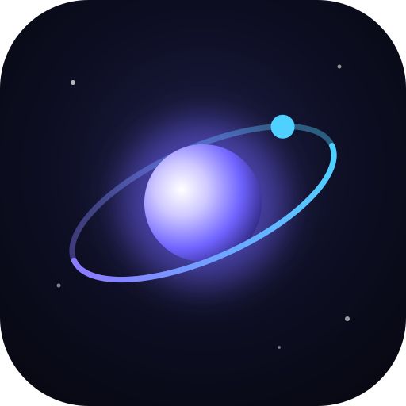
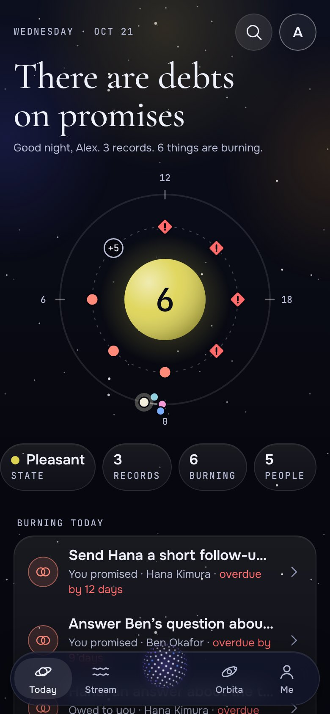
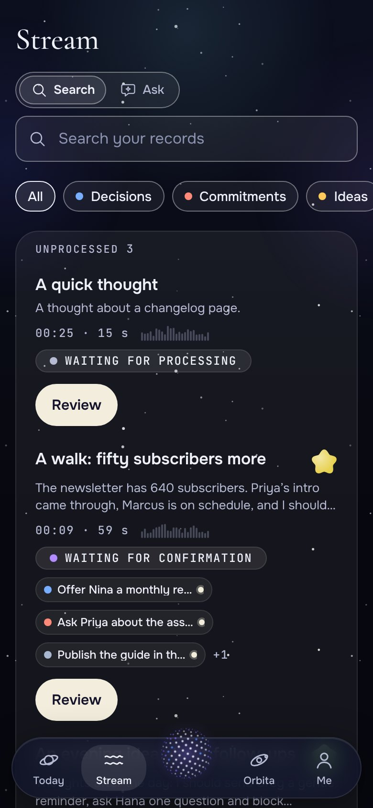
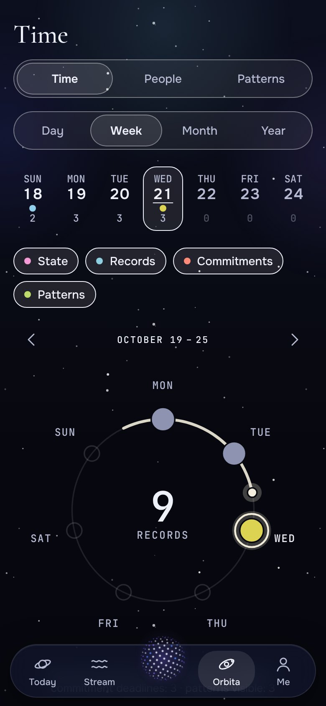
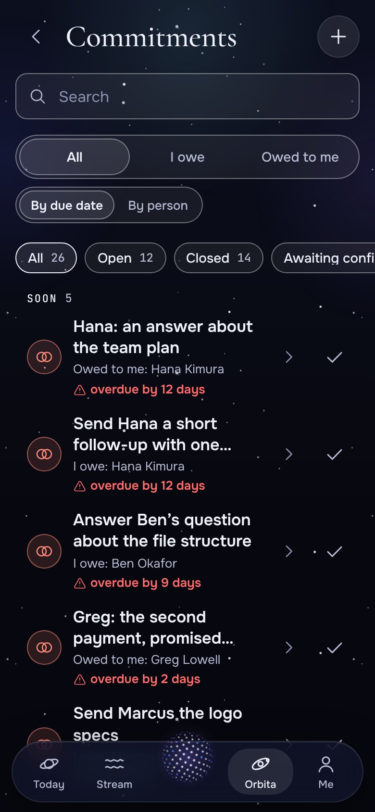

<div align="center">



# Orbita

**Think out loud. Keep what matters.**<br/>
A private, local-first journal that turns your voice notes into decisions, commitments, ideas and predictions, and gives you back reviews, patterns and a calibration of your own forecasts.

[](https://github.com/maxbzd/Orbita/actions/workflows/ci.yml)
[](LICENSE)
[](#privacy-and-your-data)
[](docs/I18N.md)

[English](README.md) · [Русский](README.ru.md)

**[▶ Open the app](https://maxbzd.github.io/Orbita/)**: runs in your browser, nothing to install

 &nbsp;  &nbsp;  &nbsp; 

</div>

Orbita is a dark, fast, installable web app (PWA) for people who think out loud: on a walk, in the car, in the shower, in
a chat with an AI. You press one button and talk (or type). Orbita keeps the raw recording, then pulls out the structure
that was hidden in it and asks you to confirm it in ten seconds. Over weeks it turns into something you cannot get from a
notes app: *what did I promise, what did I decide and why, what do I keep repeating, how good are my predictions?*

Everything is stored **on your device**. There is no account, no tracking and no server you have to trust. An AI key is
optional, and so is the cloud. Free and open source (MIT).

## Highlights

- **One-tap capture.** From the home-screen icon to a running recording in one touch. Audio is saved in chunks every
  10 seconds, so a crash or a closed tab never loses it. Voice, text, a pasted AI chat or a quick check-in.
- **Nothing is lost, nothing is guessed.** The raw recording and text always stay. The AI only *proposes* objects; you accept,
  edit or dismiss them. Every decision, idea or pattern links back to a quote in the original note.
- **Eight kinds of objects.** Decisions, commitments (what you owe and what is owed to you), ideas, predictions, tasks,
  questions, lessons and facts, plus **people**, **projects** and **check-ins** (mood, energy, focus, stress).
- **Calibration.** Give predictions a probability, close them later, and see the honest picture: "I said 70%, it came true 55%" (Brier score).
- **Reviews and patterns.** Week, month and year reviews as stories; recurring behaviour surfaced with evidence, never as a verdict.
- **Orbit.** Time and people as a night sky: days on rings, people as a constellation, brighter means fresher contact.
- **Ask your life.** A chat over your own records, with links to the notes and objects each answer came from.
- **AI context pack.** Export a clean markdown or JSON context for any AI chat, with names masked as initials or "Person A" if you like.
- **Works without AI.** No key? It is a good voice diary with manual tagging, a rule-based engine, and a copy-paste mode: copy the prompt,
  paste it into any chat, paste the answer back.
- **Yours to move.** Open-format export, encrypted backup, one-step "delete everything", password lock.
- **Seven languages**: English, Spanish, German, French, Portuguese, Ukrainian and Russian (English and Russian also cover the built-in rule-based engine and demo data; a cloud model answers in any of them). [Improve a translation or add your language](docs/I18N.md).
- **Optional cloud sync** between your devices through **your own Supabase project** ([docs/CLOUD.md](docs/CLOUD.md)).

## Quick start

Requirements: Node.js 22 or newer.

```bash
git clone https://github.com/maxbzd/Orbita.git
cd Orbita
npm install
npm run dev            # http://localhost:5173
```

Nothing has to be configured. In the onboarding choose **Load demo data** (or later **Settings → Data → Demo data**) to look
around two months of records of a made-up person. For a tour with no keys at all, run `VITE_MOCK_AI=1 npm run dev`:
a deterministic stand-in model and speech recognition.

```bash
npm run build          # type check + production build in dist/ (with a service worker for offline use)
npm run preview        # serve the production build locally
npm run check          # typecheck + i18n check + tests + build (what CI runs)
```

### Install on your phone

Open the address in Chrome (Android) or Safari (iPhone) and choose **Add to Home Screen**. On Android the icon also offers the
shortcuts *New recording* and *Check-in*, and Orbita appears in the **Share** menu. See [docs/DEPLOY.md](docs/DEPLOY.md) for
hosting your own copy in a few minutes (GitHub Pages, Netlify, Cloudflare Pages, any static host).

## Privacy and your data

- All data lives in **IndexedDB on your device**. No analytics, no telemetry, no external fonts or CDNs at runtime.
- The only thing that leaves the device is what *you* send to the AI provider you configured (your own key): a transcript to
  extract objects from, a question, a review. You can see what will be sent first.
- API keys stay on the device; with the lock enabled they are encrypted with a key derived from your password (PBKDF2 + AES-GCM).
- The cloud is **off** until you sign in to your own Supabase project, and it is honest about its limits: the data is protected
  by row-level security and your password but is not end-to-end encrypted ([docs/CLOUD.md](docs/CLOUD.md)).
- A strict Content-Security-Policy allows network requests only to the AI hosts listed in `index.html` and to Supabase.

## AI providers

| Provider | Use | Notes |
|---|---|---|
| **Anthropic** | extraction, reviews, patterns, ask | your key; structured output through tool use |
| **OpenAI-compatible** | the same, plus speech-to-text | OpenAI, Groq, OpenRouter, or a server you run; add its host to `connect-src` in `index.html` |
| **Copy and paste** | no key, no network | the app builds the prompt, you paste the JSON answer back |
| **Built-in rules** | offline extraction, search, simple reviews | English and Russian |

Model replies are treated as untrusted: strict parsing, schema validation (zod), one automatic repair, and nothing is ever
rendered as HTML. Details: [docs/ARCHITECTURE.md](docs/ARCHITECTURE.md).

## Documentation

| | |
|---|---|
| [docs/PRODUCT.md](docs/PRODUCT.md) | what Orbita is, the screens, the principles |
| [docs/ARCHITECTURE.md](docs/ARCHITECTURE.md) | stack, structure, the AI layer, privacy, performance |
| [docs/DATA_MODEL.md](docs/DATA_MODEL.md) | every type and table |
| [docs/DESIGN.md](docs/DESIGN.md) | the visual language |
| [docs/CLOUD.md](docs/CLOUD.md) | optional sync through your own Supabase project |
| [docs/DEPLOY.md](docs/DEPLOY.md) | host your own copy |
| [docs/I18N.md](docs/I18N.md) | translations and adding a language |
| [CONTRIBUTING.md](CONTRIBUTING.md) | how to help |

Every document also exists in Russian under [docs/ru/](docs/ru/).

## Tech stack

Vite 6 · React 18 · TypeScript (strict) · Dexie / IndexedDB · zustand · zod · react-router (hash router) · CSS Modules ·
MiniSearch · Motion · vite-plugin-pwa · Vitest + Testing Library + fake-indexeddb · optional Supabase. No UI framework, no
chart library, no WebGL: the orb is Canvas 2D and the charts are hand-made SVG.

```
src/
  domain/    types, zod schemas, pure functions (calibration, dates, names, similarity)
  db/        Dexie schema, migrations, repositories, demo seed, backup
  ai/        providers, prompts, extraction pipeline, reviews, patterns, ask, context pack
  audio/     recording with chunks and recovery, level meter, speech-to-text
  search/    full-text index with Russian and English normalisation
  sync/      optional cloud sync engine (talks to Supabase through one adapter)
  i18n/      dependency-free translations (English text is the key)
  ui/        design system: orb, aura, glass, buttons, sheets, navigation
  features/  one folder per screen: today, capture, stream, orbit, items, people, ...
```

## Quality

The unit and component suite (about 2,700 tests) covers the data layer, the AI pipeline against garbage model
output, the search, the sync engine with two fake devices, the backup format, and both languages. CI runs the type check,
the i18n check, the tests and the build on every push.

## Companion project

**[Aster](https://github.com/maxbzd/Aster)** is a sister open-source app: a personal CRM for the people you care about.
Both are local-first, share the same design language and can be self-hosted side by side.

## Contributing

Bug reports, fixes, features, translations and docs are welcome. Start with [CONTRIBUTING.md](CONTRIBUTING.md). Security
problems go through [SECURITY.md](SECURITY.md). Be kind: [Code of Conduct](CODE_OF_CONDUCT.md).

## License

[MIT](LICENSE)
