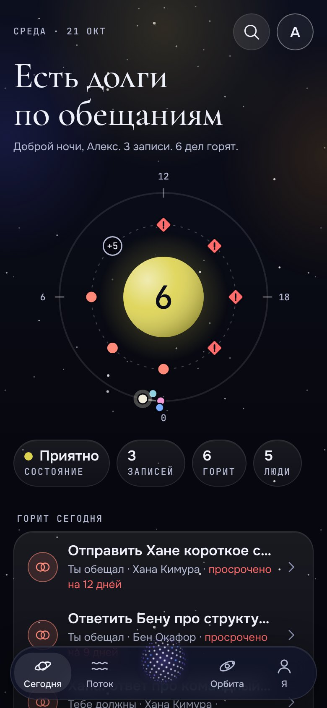
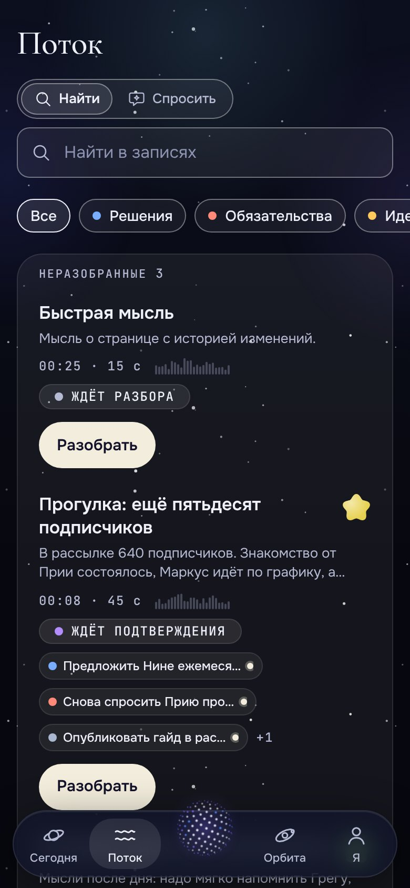
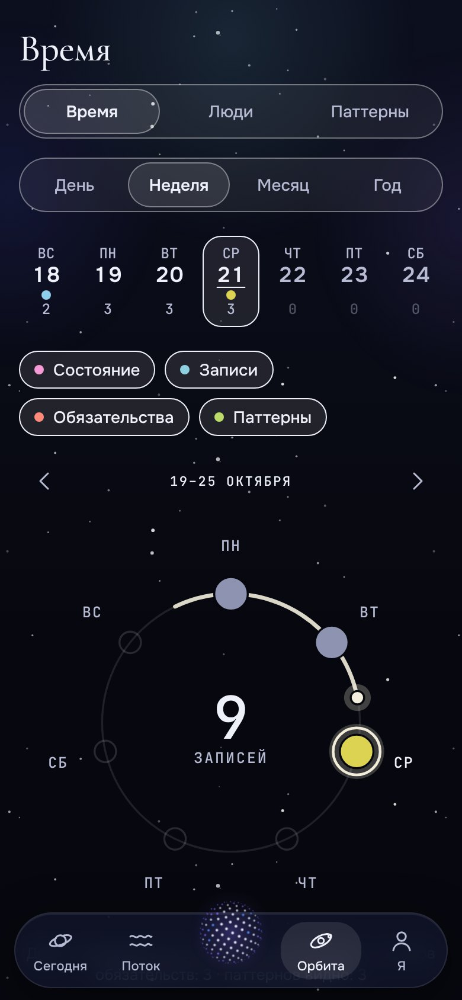
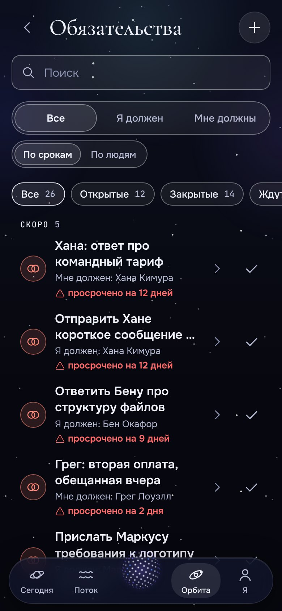

<div align="center">


# Орбита

**Думай вслух. Сохраняй главное.**<br/>
Приватный дневник с хранением на устройстве: превращает голосовые заметки в решения, обязательства, идеи и прогнозы, а взамен даёт обзоры, паттерны и калибровку твоих прогнозов.

[](https://github.com/maxbzd/Orbita/actions/workflows/ci.yml)
[](LICENSE)
[](#приватность-и-ваши-данные)
[](docs/ru/I18N.md)

[English](README.md) · [Русский](README.ru.md)

 &nbsp;  &nbsp;  &nbsp; 

</div>

Орбита (Orbita) — тёмное, быстрое, устанавливаемое веб-приложение (PWA) для тех, кто думает вслух: на прогулке, в машине, в душе,
в чате с ИИ. Нажимаешь одну кнопку и говоришь (или пишешь). Орбита сохраняет исходную запись, достаёт из неё скрытую структуру и
просит подтвердить её за десять секунд. Через несколько недель это превращается в то, чего не даёт обычный блокнот:
*что я обещал, что и почему решил, что у меня повторяется, насколько точны мои прогнозы?*

Всё хранится **на вашем устройстве**. Никакого аккаунта, слежки и сервера, которому нужно доверять. Ключ ИИ необязателен,
облако тоже. Бесплатно и с открытым кодом (MIT).

## Возможности

- **Запись в одно касание.** От иконки на домашнем экране до идущей записи — одно касание. Звук сохраняется кусками
  каждые 10 секунд, поэтому сбой или закрытая вкладка его не теряют. Голос, текст, вставленный диалог с ИИ или быстрый чек-ин.
- **Ничего не теряется и не додумывается.** Исходное аудио и текст остаются всегда. ИИ только *предлагает* объекты, вы принимаете,
  правите или отклоняете. У каждого решения, идеи и паттерна есть ссылка на цитату в исходной записи.
- **Восемь видов объектов.** Решения, обязательства (что должны вы и что должны вам), идеи, прогнозы, задачи, вопросы, уроки
  и факты, а ещё **люди**, **проекты** и **чек-ины** (настроение, энергия, фокус, стресс).
- **Калибровка.** Ставьте прогнозам вероятность, закрывайте позже и смотрите честную картину: «говорил 70 %, сбылось 55 %» (оценка Брайера).
- **Обзоры и паттерны.** Недельные, месячные и годовые обзоры в виде историй; повторяющееся поведение с доказательствами, а не приговор.
- **Орбита.** Время и люди как ночное небо: дни на кольцах, люди как созвездие, чем ярче — тем свежее контакт.
- **Спросить свою жизнь.** Чат по вашим записям, у каждого ответа ссылки на заметки и объекты, из которых он собран.
- **Контекст для ИИ.** Выгрузка аккуратного markdown или JSON для любого ИИ-чата, имена можно скрыть: инициалы или «Человек A».
- **Работает без ИИ.** Нет ключа? Это хороший голосовой дневник с ручной разметкой, встроенный правиловый движок и режим
  «через буфер обмена»: скопировали промпт, вставили в любой чат, вставили ответ обратно.
- **Данные ваши.** Экспорт в открытом формате, шифрованная копия, удаление всего в один шаг, блокировка паролем.
- **Русский и английский**, включая встроенный движок, промпты ИИ и демо-данные. [Добавить свой язык](docs/ru/I18N.md).
- **Облако по желанию:** синхронизация между устройствами через **ваш собственный проект Supabase** ([docs/ru/CLOUD.md](docs/ru/CLOUD.md)).

## Быстрый старт

Нужен Node.js 22 или новее.

```bash
git clone https://github.com/maxbzd/Orbita.git
cd Orbita
npm install
npm run dev            # http://localhost:5173
```

Ничего настраивать не нужно. В онбординге выберите **Загрузить демо-данные** (или позже **Настройки → Данные → Демо-данные**),
чтобы посмотреть два месяца записей вымышленного человека. Для знакомства совсем без ключей запустите
`VITE_MOCK_AI=1 npm run dev`: включаются детерминированная заглушка модели и распознавания речи.

```bash
npm run build          # проверка типов и сборка в dist/ (с service worker для офлайна)
npm run preview        # локальный просмотр собранной версии
npm run check          # типы + i18n + тесты + сборка (то, что запускает CI)
```

### Установка на телефон

Откройте адрес в Chrome (Android) или Safari (iPhone) и выберите **«Добавить на экран „Домой“»**. На Android в меню иконки появятся
ярлыки «Новая запись» и «Чек-ин», а Орбита станет доступна в меню **«Поделиться»**. Как развернуть собственную копию за пару минут
(GitHub Pages, Netlify, Cloudflare Pages, любая статика) — в [docs/ru/DEPLOY.md](docs/ru/DEPLOY.md).

## Приватность и ваши данные

- Все данные лежат в **IndexedDB на вашем устройстве**. Нет аналитики, телеметрии, внешних шрифтов и CDN в рантайме.
- Наружу уходит только то, что *вы сами* отправили выбранному провайдеру ИИ (с вашим ключом): транскрипт для извлечения, вопрос,
  обзор. Что именно уйдёт, можно увидеть заранее.
- Ключи API остаются на устройстве; с включённой блокировкой они шифруются ключом из пароля (PBKDF2 + AES-GCM).
- Облако **выключено**, пока вы не войдёте в собственный проект Supabase, и честно об ограничениях: данные защищены политиками
  строк (RLS) и паролем, но не зашифрованы сквозным шифрованием ([docs/ru/CLOUD.md](docs/ru/CLOUD.md)).
- Строгая политика безопасности контента (CSP) разрешает сетевые запросы только к хостам ИИ из `index.html` и к Supabase.

## Провайдеры ИИ

| Провайдер | Для чего | Заметки |
|---|---|---|
| **Anthropic** | извлечение, обзоры, паттерны, «спросить» | ваш ключ; структурный вывод через tool use |
| **OpenAI-совместимый** | то же и распознавание речи | OpenAI, Groq, OpenRouter или свой сервер; его хост нужно добавить в `connect-src` в `index.html` |
| **Через буфер обмена** | без ключа и сети | приложение собирает промпт, вы вставляете JSON-ответ обратно |
| **Встроенные правила** | офлайн-извлечение, поиск, простые обзоры | русский и английский |

Ответы модели считаются недоверенными: строгий разбор, проверка схемы (zod), одна автопочинка, ничего не выводится как HTML.
Подробности — [docs/ru/ARCHITECTURE.md](docs/ru/ARCHITECTURE.md).

## Документация

Каждый документ есть на русском в [docs/ru/](docs/ru/) и на английском в [docs/](docs/).

| | |
|---|---|
| [PRODUCT](docs/ru/PRODUCT.md) | что такое Орбита, экраны, принципы |
| [ARCHITECTURE](docs/ru/ARCHITECTURE.md) | стек, структура, слой ИИ, приватность, производительность |
| [DATA_MODEL](docs/ru/DATA_MODEL.md) | все типы и таблицы |
| [DESIGN](docs/ru/DESIGN.md) | визуальный язык |
| [CLOUD](docs/ru/CLOUD.md) | синхронизация через ваш Supabase |
| [DEPLOY](docs/ru/DEPLOY.md) | своя копия на хостинге |
| [I18N](docs/ru/I18N.md) | переводы и добавление языка |
| [CONTRIBUTING](CONTRIBUTING.md) | как помочь проекту (на английском) |

## Стек

Vite 6 · React 18 · TypeScript (strict) · Dexie / IndexedDB · zustand · zod · react-router (hash-роутер) · CSS Modules ·
MiniSearch · Motion · vite-plugin-pwa · Vitest + Testing Library + fake-indexeddb · опционально Supabase. Без UI-фреймворка, без
библиотеки графиков, без WebGL: орб рисуется на Canvas 2D, графики — вручную в SVG.

```
src/
  domain/    типы, zod-схемы, чистые функции (калибровка, даты, имена, сходство)
  db/        схема Dexie, миграции, репозитории, демо-данные, резервные копии
  ai/        провайдеры, промпты, конвейер извлечения, обзоры, паттерны, «спросить», контекст-пак
  audio/     запись кусками с восстановлением, уровень громкости, распознавание речи
  search/    полнотекстовый индекс с русской и английской нормализацией
  sync/      опциональный движок облачной синхронизации (с Supabase через один адаптер)
  i18n/      переводы без зависимостей (английский текст = ключ)
  ui/        дизайн-система: орб, аура, стекло, кнопки, листы, навигация
  features/  по папке на экран: today, capture, stream, orbit, items, people, ...
```

## Качество

Юнит- и компонентные тесты (около 2700) покрывают слой данных, конвейер ИИ на мусорных ответах модели, поиск, движок
синхронизации с двумя «устройствами», формат резервной копии и оба языка. CI на каждый пуш запускает проверку типов, проверку
переводов, тесты и сборку.

## Родственный проект

**[Aster](https://github.com/maxbzd/Aster)** — сестринское open-source приложение: личная CRM для людей, которые вам дороги. Оба
проекта local-first, с общим визуальным языком, и ставятся на собственный хостинг рядом.

## Участие

Баг-репорты, исправления, новые возможности, переводы и документация приветствуются. Начните с [CONTRIBUTING.md](CONTRIBUTING.md).
Проблемы безопасности — через [SECURITY.md](SECURITY.md). Будьте добры друг к другу: [Кодекс поведения](CODE_OF_CONDUCT.md).

## Лицензия

[MIT](LICENSE)
